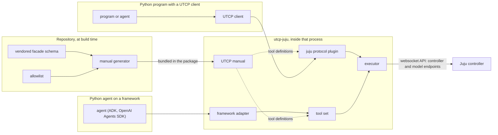

# About the design of utcp-juju

utcp-juju gives an AI agent Juju operations as ordinary function tools. This page explains
where those tools come from, why they reach Juju the way they do, and what keeps the
default mode read-only. It describes the reasoning, not the steps; for setup and use, see
the [README](../../README.md) and the [examples](../../examples/README.md).

## Juju already describes its own API

Every Juju client — the `juju` CLI, python-libjuju, the dashboard — talks to the
controller through the same API: JSON messages over a websocket, grouped into *facades*
such as `Client`, `Application` or `ModelManager`, each with its own version number. A
request names a facade, a version and a method, and carries parameters.

What makes this API a good foundation for agent tools is that Juju ships a machine-readable
description of it. `apiserver/facades/schema.json` in the juju repository lists every
client facade with a JSON Schema for each method's parameters and result. python-libjuju is
generated from the same file. For Juju it plays the part an OpenAPI document plays for a
REST service: it says what can be called and what comes back.

So the question this project answers is not "how do we describe Juju to an agent" — Juju
has done that — but "how do we turn that description into tools an agent can call safely".

## Why not wrap the CLI, or run an MCP server

There are two other common ways to give an agent Juju access. Both work; the reason this
project takes neither is security.

**The `juju` CLI as a tool.** A tool that runs `juju` commands gives the agent the full
power of the CLI and of whatever identity the host's client store holds, which is often an
administrator. Limiting it to read operations means filtering command lines: deciding from
a string whether a command, with its subcommands, flags and arguments, can change anything.
That is an allowlist of text rather than of operations, and it is easy to get subtly wrong
— a missed flag, an argument that smuggles in another option, a command that looks like a
query but opens a session on a machine. The client store itself, with its credentials, also
has to live on the agent's host, readable by everything that runs there.

**A separate MCP server.** An MCP server can expose a curated set of Juju tools, so the tool
surface is better controlled. But the server holds the Juju credentials in a process of its
own, and its tools are reachable by any MCP client that can connect to it. Who that is
depends on the transport's authentication — bearer tokens, or OAuth for remote servers —
which is still maturing in the MCP ecosystem and easy to misconfigure. Securing Juju
access then also means securing, deploying and auditing another network-facing service.

A library keeps the security boundary where it already is. The tools exist only as the
operations generated into the manual, with no generic command path to escape through. The
agent's own process holds the Juju credentials, taken from the secret store it already uses,
and nothing listens on the network. And the credentials can belong to a dedicated user that
Juju itself limits to reading, which the next sections build on.

## From schema to tools

Not every method in the schema should become a tool, so the generator starts from an
*allowlist*: a short file naming the facade methods to expose, each with a one-sentence
description written for the agent and, where useful, default arguments. The allowlist names
methods only. It deliberately does not point at source files or line numbers, which would
go stale as Juju changes.

For each allowlisted method the generator:

- expands every `$ref` in the parameter schema, so the agent sees plain JSON Schema;
- adds a `model` argument, since every model-scoped call needs to know which model;
- keeps only the top levels of the result schema, enough for an agent to know what comes
  back without inflating every tool description;
- records which facade version to request for each Juju series;
- validates the result as a UTCP manual before writing it.

The schema is vendored into the repository together with the juju tag and commit it was
taken from. That record is what makes updates manageable: vendoring a newer release shows,
as an ordinary git diff, exactly which methods changed, and a reviewer reads the
implementation of an allowlisted method at the recorded commit, not at whatever the juju
main branch happens to contain. A check in the test suite fails when the committed manual no
longer matches the schema and the allowlist, so the two cannot drift silently.

## Where UTCP fits

The generated tools are a [UTCP](https://www.utcp.io) manual: a list of tools, each with an
input schema and a *call template* that says how to execute it. UTCP is often used with
OpenAPI, because its HTTP plugin can turn an OpenAPI document into a manual, but UTCP itself
is not tied to HTTP. A protocol plugin can define its own call template type, and this
project defines `juju`: a template naming the facade, the method and the facade versions.

The manual is generated once, in the repository, and ships inside the package together with
everything needed to execute it. At run time the package lives inside whichever Python
process uses it, and there are two ways in, depending on what that process already is.
Both end in the same executor, so a tool behaves the same whichever way it is called.

### A Python program that already uses UTCP

This is a program whose tools already come through a UTCP client — often an agent
platform that loads its other services from OpenAPI documents, but it need not involve an
LLM at all. For it, Juju is one more manual:

- Installing utcp-juju registers the `juju` plugin with UTCP through a package entry point;
  no code runs to do it.
- The client is configured with a single manual entry of type `juju`. When it registers that
  entry, the plugin hands it the bundled manual, and the Juju tools appear next to the
  program's other tools.
- Calling one of them goes from the client to the plugin, and from the plugin to the
  executor.

The program keeps its own way of listing, filtering and approving tools; the Juju tools take
part in it like any other UTCP tools. The UTCP client example shows this path.

### A Python agent built on a framework

This is an agent written directly with an agent framework, which has its own notion of a
tool and no UTCP client. For it, an adapter turns the bundled manual into that framework's
tool type — one tool per Juju operation, carrying the input schema and description from the
manual — and the agent is given the list like any other tools. When the model calls one, the
adapter passes the arguments through the tool set to the executor. The ADK and OpenAI
Agents SDK examples show this path.

### Agent tools that are not Python

Both paths need a Python process, because the executor is Python. The manual itself is
language-neutral, but a UTCP client in another language has no `juju` plugin to execute it,
and agent tools that are not Python programs cannot import an adapter. Those need a bridge
that runs the executor for them, such as a local MCP server they start as a subprocess; that
keeps the tool surface and the credentials on the same host, unlike the network-facing MCP
server discussed above.

The [examples](../../examples/README.md) cover the first two paths.

## What happens on a call

The executor's job is mechanical translation, so the agent does not have to reason about
Juju's wire format. For a call it:

1. resolves the model the agent named — by name, `owner/name` or UUID — to the model's
   UUID, which decides which API endpoint to use;
2. connects and logs in with the configured user;
3. checks that the controller serves the facade version the manual records for its Juju
   series, and refuses with a clear message if it does not, rather than guessing at an older
   version;
4. fills in default arguments, sends the request and returns the JSON result;
5. turns a Juju error into text the agent can read, instead of an exception.

The split of responsibilities is intentional. Anything that follows a fixed rule — model
lookup, endpoint selection, version selection — lives in code once. What the agent needs
to know is semantic: which operation answers which question, and in what order to look at
things during an investigation. That belongs in the agent's instructions, not in every tool
call.

The executor is stateless by design. It does not watch the model, keep a copy of its state
or build typed objects from responses; it returns what the controller sent. Clients that
maintain a live model mirror pay for it in memory and CPU on large models, and an agent
that asks a question and reads the answer has no use for one. Statelessness is also what
keeps the per-call cost visible: a call costs one connection and one login, which can be
amortised by pooling connections should call volume ever require it.

## Read-only by default

The default mode is read-only, and it rests on two independent layers.

The first is structural. Only allowlisted methods become tools, and the allowlist only holds
methods whose implementation reads state and nothing else: no writes, no secret material in
the result, no calls out to external services. A write method is not refused when the
agent calls it; it simply does not exist as a tool. The review behind each entry matters
because method names are not a reliable guide. A method that looks like a query can, on
inspection, write a cache to the database on first use, mint a credential, or reach out to
a cloud provider.

The second layer is Juju's own permission model. The recommended setup runs the tools as a
dedicated Juju user granted only `read` on the models the agent may see. Even if a write
method were allowlisted by mistake, or a request were crafted by hand, the controller would
refuse it.

Neither layer depends on the agent's prompt. An agent that is told to be careful and an
agent that is not have exactly the same reach.

## Versions

Juju numbers each facade independently, and a controller serves a range of versions for
backward compatibility. The manual records, for each tool and each supported Juju series,
the facade version to request, taken from the vendored schema. The tool names and inputs the
agent sees therefore stay the same across controllers; only the version sent on the wire is
looked up.

The executor does not negotiate. If a controller does not serve the recorded version, the
call fails with a message saying so, instead of silently falling back to an older version
whose parameters or results might differ. Supporting a new series means vendoring its
schema, reviewing what changed for the allowlisted methods, and adding its versions to the
manual; the mechanism stays the same.

## Further reading

- [README](../../README.md): installation, configuration and the development recipes.
- [Examples](../../examples/README.md): two minimal agents, one per framework, run end to
  end against an example model.
- [UTCP](https://www.utcp.io): manuals, call templates and protocol plugins.
